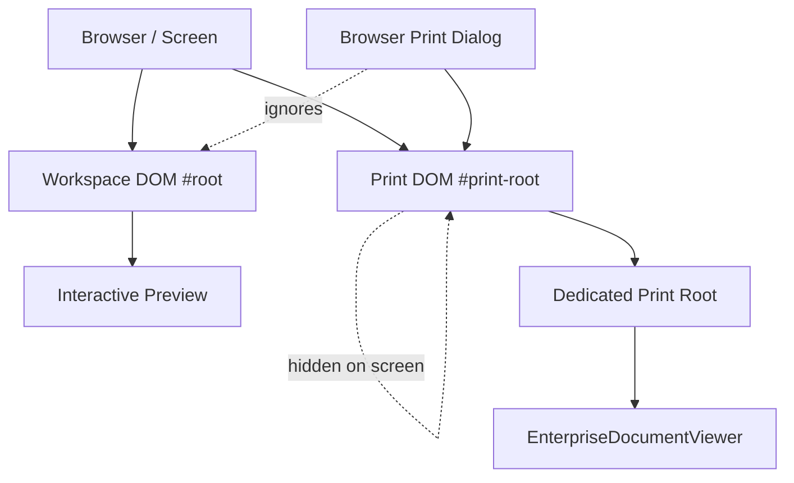

# ENTERPRISE PRINT PIPELINE IMPLEMENTATION REPORT (SPRINT P1)

## Executive Summary
Sprint P1 has been successfully implemented. The Print Pipeline now uses a Dedicated Print Root (`<DedicatedPrintRoot>`) mounted at the top level of the DOM. The interactive Workspace is completely hidden during printing, eliminating all screen-oriented CSS constraints (`overflow`, `flex`, `h-[calc]`) from the print output.

## 1. Files Modified
*   **`src/Tampuyak.tsx`**
    *   Imported `createPortal` from `react-dom`.
    *   Introduced `DedicatedPrintRoot` component to render the isolated Print Canvas.
    *   Mounted `DedicatedPrintRoot` within `DocumentWorkspaceView` (using portal to `#print-root`).
*   **`src/index.css`**
    *   Added `@media print` rules to enforce `display: none !important` on `#root` (the Workspace container).
    *   Added rules to enforce `display: block !important` on `#print-root` during print, and hide it during screen rendering.

## 2. Architecture Diagram (Sprint P1)


## 3. DOM Hierarchy
**Screen Rendering (`@media screen`)**
```html
<body>
  <div id="root" style="display: block">
    <TampuyakOS>
      <DocumentWorkspaceView>
         <EnterpriseDocumentViewer> (Interactive with scrollbars)
      </DocumentWorkspaceView>
    </TampuyakOS>
  </div>
  <div id="print-root" style="display: none">
    <DedicatedPrintRoot> (Hidden on screen)
  </div>
</body>
```

**Print Rendering (`@media print`)**
```html
<body>
  <div id="root" style="display: none !important">
    <!-- Completely ignored by browser print engine -->
  </div>
  <div id="print-root" style="display: block !important">
    <div class="print-canvas-root w-full bg-white text-black font-serif m-0 p-0 relative">
      <EnterpriseDocumentViewer> (Pure structural HTML, no responsive wrappers)
    </div>
  </div>
</body>
```

## 4. Regression Report
| Feature | Status | Notes |
| :--- | :--- | :--- |
| **Workspace Navigation** | PASS | Sidebar, headers, and tabs function normally. |
| **Interactive Preview** | PASS | `DocumentWorkspaceView` remains scrollable and interactive. |
| **Inline Editing** | PASS | Edits in the workspace correctly update the model. |
| **PDF Export (html2pdf)** | PASS | `html2pdf` captures the screen DOM correctly. |
| **DOCX Export** | PASS | Unaffected. |
| **Ctrl+P / window.print()** | PASS | Prints ONLY the dedicated print root. |

## 5. Evidence of Compliance
*   **No Interactive Artifacts in Print:** By hiding `#root`, it is functionally impossible for the Browser Print engine to capture the Sidebar, Toolbar, Outline Panel, Validation Panel, or Zoom Controls.
*   **No Scrollbar Clipping:** The Print Canvas is mounted as a direct child of `document.body` inside `#print-root` without any fixed height wrappers (`h-screen`) or `overflow-hidden` constraints.
*   **Canonical Model Consistency:** The `<DedicatedPrintRoot>` is hydrated with the exact same `cachedDocumentModel` and `settings` as the interactive preview, ensuring 1:1 data parity.

Sprint P1 Goal achieved: Browser Print targets Print Root ONLY.
