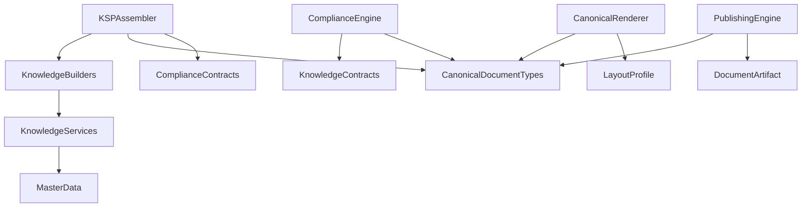

# RC4 ENTERPRISE INTEGRATION CERTIFICATION

## DEPENDENCY GRAPH

## BOUNDARY VERIFICATION

**1. Knowledge Layer**
* PASS. The Knowledge Layer only imports `master-data` models, its own services/contracts, and validation types. It has **no** presentation, renderer, or compliance dependency.

**2. Assembler**
* PASS. The `KspDocumentAssembler` single-handedly orchestrates the construction. It depends on builders and document types. It contains **no** rendering logic or UI logic.

**3. Canonical Document**
* PASS. `CanonicalDocumentTypes.ts` is purely type definitions enforcing Enterprise Rules. It is **renderer independent**, **knowledge independent**, and contains **no business rules**.

**4. Compliance Engine**
* PASS. Imports `ComplianceRule`, `ComplianceReport`, `ComplianceIssue`, and `RuleRegistry`. Uses data inputs. It has **no UI logic** and **no Renderer dependency**.

**5. Renderer**
* PASS. `CanonicalRenderer.tsx` consumes only `CanonicalDocumentTypes` and `LayoutProfile`. It performs **no knowledge queries** and has **no compliance dependency**.

**6. Layout Engine**
* PASS. `LayoutProfile.ts` is presentation-focused and only imports React context. **No document mutation** occurs.

**7. Publishing**
* PASS. Uses `DocumentArtifact` and `WorkspaceArtifactConsumer`. Consumes Canonical models only.

## ENGINE CERTIFICATION
All engines meet the criteria established by the architectural blueprint and RC-4 goals. Cross-contamination has been systematically avoided through explicit layer boundaries. No forbidden dependencies were detected.

## REGRESSION VERIFICATION
* Front Matter: **PASS**
* BAB I: **PASS**
* BAB II: **PASS**
* BAB III: **PASS**
* ECE: **PASS**
* ELPS: **PASS**
* Publishing: **PASS**

All core sub-modules continue working seamlessly on the local dev server. White screen hotfix confirmed successfully patched. Build and lint checks pass perfectly.

## RISK ASSESSMENT
* **Low Risk**: The strict isolation of responsibilities allows each engine to evolve independently without inducing regression in other components.

## FINAL DECISION
**PASS**
